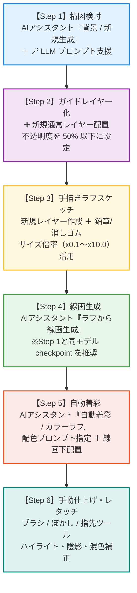

# AI アシスタント イラスト制作ワークフロー作例ガイド
## (AI Illustration Workflow Guide)

『PaintSoft KABURAGI』の**AI アシスタント機能**と手描画ツール（鉛筆・ブラシ・ぼかし・指先など）をシームレスに連携させ、構図の検討からラフスケッチ、AIによる清書・線画化、自動着彩、そして手作業でのレタッチ仕上げまでを一連のパイプラインで行う実践的なイラスト制作ワークフローガイドです。

---

## ワークフロー全体図



---

## 目次
1. [事前準備：AI アシスタントパネルの表示と環境設定](#事前準備ai-アシスタントパネルの表示と環境設定)
2. [Step 1：背景 / 新規作成モードでLLMを活用して構図検討](#step-1背景--新規作成モードでllmを活用して構図検討)
3. [Step 2：生成画像を新規レイヤー化し不透明度を50%以下に設定](#step-2生成画像を新規レイヤー化し不透明度を50以下に設定)
4. [Step 3：新規レイヤーを作成し、鉛筆・消しゴムツールでラフを作成](#step-3新規レイヤーを作成し鉛筆消しゴムツールでラフを作成)
5. [Step 4：AIアシスタント「ラフから線画作成」で線画レイヤーを作成](#step-4aiアシスタントラフから線画作成で線画レイヤーを作成)
6. [Step 5：AIアシスタント「着色」で着色レイヤーを作成](#step-5aiアシスタント着色で着色レイヤーを作成)
7. [Step 6：ブラシ・ぼかし・指先ツール等で着色レイヤーを手動修正・仕上げ](#step-6ブラシぼかし指先ツール等で着色レイヤーを手動修正仕上げ)
8. [便利なショートカット＆Tips一覧](#便利なショートカットtips一覧)

---

## 事前準備：AI アシスタントパネルの表示と環境設定

### 1. パネルの表示
- 画面上部メニューの **[ウィンドウ]** → **[ドック]** → **[AI アシスタント]** にチェックを入れ、パネルを表示します。
- 画面右側または好みのドックエリアにドッキングして配置します。

### 2. 推論環境とデバイスの確認
パネル上部の「エンジン設定」グループを確認します：
- **推論バックエンド**:
  - **組み込みエンジン (内蔵 sd.exe)**: 追加サーバー不要。Vulkan / DirectML によるGPUハードウェアアクセラレーションに対応しています。
  - **ComfyUI / Stable Diffusion WebUI**: 外部サーバーを起動している場合、CUDA による高速推論が可能です。
- **推論デバイス**:
  - `Vulkan (GPUハードウェアアクセラレーション)` または `CUDA (NVIDIA GPU)` を選択することで、高速かつ快適に生成を行えます。

---

## Step 1：背景 / 新規作成モードでLLMを活用して構図検討

ゼロから構図のインスピレーションを得るため、自然言語でイメージを膨らませてベース画像を生成します。

```
[AI アシスタントパネル]
┌──────────────────────────────────────────────┐
│ 生成モード: [ 背景 / 新規生成 (Background) ▼ ] │
├──────────────────────────────────────────────┤
│ プロンプト:                                  │
│ [ 1girl, fantasy town, sunset, looking at... ]│
│                                              │
│ [ 🪄 LLM プロンプト支援... ]                   │
└──────────────────────────────────────────────┘
```

### 操作手順
1. AI アシスタントパネル上部の **生成モード** コンボボックスから **[背景 / 新規生成 (Background / New)]** を選択します。
2. **[🪄 LLM プロンプト支援...]** ボタンをクリックします。
3. **LLM プロンプト支援ダイアログ** が表示されます：
   - 使用するローカルLLM（Ollama, LM Studio, llama.cpp 等）または OpenAI 互換 API を選択します。
   - **日本語のプロンプト入力欄** に、作りたいイラストのイメージを自由に入力します。  
     *入力例:「夕暮れのファンタジー世界の路地裏、レンガ造りの街並み、杖を持った見習い魔法使いの少女、ドラマチックな逆光」*
   - **[プロンプト生成]** をクリックすると、LLMがStable Diffusionに最適な英語の品質タグ・構図指示（`masterpiece, best quality, ultra-detailed, narrow alley, fantasy medieval town, sunset glow, rim lighting...`）やネガティブプロンプトを自動構築します。
   - 内容を確認し、**[プロンプトに反映]** をクリックするとAIアシスタントのプロンプト欄へ即座に転記されます。
4. **生成パラメータ** を設定します：
   - **幅 / 高さ**: キャンバスの比率に合わせます（例: 832×1216 または 1024×1024）。
   - **ステップ数**: 20〜30（標準的なクオリティ）。
   - **CFG スケール**: 7.0（プロンプトへの忠実度）。
   - **シード値**: `-1`（ランダム）。
5. **[🚀 生成開始]** をクリックします。
6. プログレスバーが進み、中央のプレビューエリアに構図案の画像が表示されます。気に入った構図が出るまでシードを変えて数回試行します。

> [!TIP]
> **LLMプロンプト支援の利点**:  
> 単語の羅列を考える必要がなく、「こういう世界観で、こんな光が差していて、こういう感情のキャラクター」と日本語で入力するだけで、構図・背景・ライティングのタグがバランス良く盛り込まれたプロンプトが生成されます。

---

## Step 2：生成画像を新規レイヤー化し不透明度を50%以下に設定

生成した画像をそのまま完成品にするのではなく、**自分の手描きスケッチのための「下絵・構図アタリ（ガイド）」** としてキャンバスに取り込みます。

```
[プレビュー] ──[ ➕ 新規通常レイヤー ]──▶ [キャンバス (Layer: AI生成)]
                                                  │
                                                  ▼
                               [レイヤーパネル: 不透明度 30%〜40%]
```

### 操作手順
1. AI アシスタントパネル下部の **[➕ 新規通常レイヤー]** ボタンをクリックします。
   - 現在のキャンバスに「AI生成」という名称で新規ラスターレイヤーが自動追加され、生成画像が貼り付けられます。
2. 画面右側（またはドック内）の **レイヤーパネル** を開きます。
3. いま追加されたAI生成レイヤーを選択し、パネル上部にある **「不透明度スライダー」** を操作します。
4. 不透明度を **50%以下（おすすめは 30% 〜 40% 程度）** に設定します。
   - 画像が薄くなり、この上に線を描いても邪魔にならない「下絵ガイド」の状態になります。
5. （任意）誤ってこのレイヤーに描き込まないよう、レイヤーパネルの **[保護（鍵アイコン）]** をクリックしてロックしておくことを推奨します。

> [!NOTE]
> 不透明度を50%以下に下げることで、AIが提示した光の方向やパース、背景の配置を意識しつつも、自分の好きな骨格・ポーズ・オリジナルデザインへとアレンジしやすくなります。

---

## Step 3：新規レイヤーを作成し、鉛筆・消しゴムツールでラフを作成

AIの下絵を参考にしながら、オリジナルのポーズ、表情、衣装、髪型などのラフスケッチを描き起こします。

```
[レイヤー構成]
┌───────────────────────────────────────┐
│ [通常] ラフスケッチ (描画中: 100%)    │  ← ここに鉛筆で描画
├───────────────────────────────────────┤
│ [通常] AI生成下絵 (不透明度: 35% 🔒)  │  ← Step 2 のガイド
├───────────────────────────────────────┤
│ [通常] 背景 (白地)                    │
└───────────────────────────────────────┘
```

### 操作手順
1. レイヤーパネル下部の **[➕ 新規通常レイヤー]** アイコンをクリック（またはショートカット `Ctrl+Shift+N`）して、AI下絵レイヤーの「上」に新しいレイヤーを作成します。
   - レイヤー名をダブルクリックして「ラフ」に変更しておくと分かりやすくなります。
2. ツールボックスから **鉛筆ツール**（ショートカット: `P`）を選択します。
3. 画面左または上部の **ツールプロパティ** でペンの設定を調整します：
   - **サイズ倍率コンボボックス**:
     - `x 0.1`: 0.1 〜 10 px（細部の微調整）
     - `x 1.0` *(標準)*: 1 〜 100 px（通常のアタリ・ラフ描き）
     - `x 5.0` / `x 10.0`: 5 〜 1000 px（大きなアタリや陰影のアタリ）
   - **サイズ**: 3 〜 8 px 程度（描きやすい太さ）。
   - **不透明度 / 濃度**: 80 〜 100%。
   - **手ブレ補正**: 5 〜 10（自然なストローク）。
4. キャンバス上で、AI下絵の構図を活かしながらキャラクターの主線やシルエット、表情をガシガシ描き込みます。
5. 線を削ったり整えたりしたいときは、**消しゴムツール**（ショートカット: `E`）に切り替えて不要な線を消去します。
   - 描画色を透明色にするショートカット（`C`）を使って鉛筆のまま消すことも可能です。
6. ラフが完成したら、Step 2の「AI生成下絵レイヤー」の目玉アイコンをクリックして非表示にし、ラフのシルエットや線の勢いを確認します。

---

## Step 4：AIアシスタント「ラフから線画作成」で線画レイヤーを作成

自分が描いたラフスケッチの線をベースにして、AIにブレのないクリーンな清書線画（Lineart）を生成させます。

```
[手描きラフ] ──▶ [AI: ラフから線画生成 (Sketch2Lineart)] ──▶ [清書線画レイヤー]
                 ※ Step 1と同じモデル checkpoint を使用
```

### 操作手順
1. レイヤーパネルで、Step 3で描いた **「ラフ」レイヤーを選択（アクティブ化）** します。
   - （必要に応じて、AI下絵レイヤーは非表示にしてラフの線だけがキャンバスに見えている状態にします）
2. AI アシスタントパネルの **生成モード** を **[ラフから線画生成 (Sketch2Lineart)]** に切り替えます。
3. **重要：使用モデル（Checkpoint）の選択**：
   - モデル一覧から、**【Step 1の構図検討で使用したモデルと全く同一のモデル】** を選択してください。
4. **プロンプトの設定**:
   - Step 1のプロンプトをベースにしつつ、線画に特化した単語を追加します：  
     `lineart, clean outline, monochrome sketch, master lineart, smooth line work, coloring book, sharp focus, (worst quality, blurry, shading, color:1.4 in negative)`
5. **ControlNet / 抽出設定**:
   - **Lineart Preprocessor / エッジ感度**: ラフの線の太さに合わせて調整します。
   - **Denoising 強度**: 0.55 〜 0.70（ラフの形状をしっかり残しつつ清書化）。
6. **[🚀 生成開始]** をクリックします。
7. 生成されたシャープで歪みのない清書線画を確認し、パネル下部の **[➕ 新規通常レイヤー]** をクリックしてキャンバスに追加します。
8. レイヤーパネルで新規線画レイヤーを選択し、合成モードを **[乗算 (Multiply)]** に変更します。

> [!IMPORTANT]
> **なぜStep 1と同じモデルを使うのか？**:  
> Stable Diffusionのモデル（アニメ系、リアル系、厚塗り系など）は、学習されたタッチや線の引き方、瞳や髪のデフォルメ表現の解釈がモデルごとに大きく異なります。Step 1と異なるモデルを使うと、構図やキャラクターデザインのニュアンスが崩れてしまったり、画風の乖離が生じる原因になります。**最初から最後まで一貫して同じモデルCheckpointを指定すること**が、統一感のある高品質な仕上がりにする最も重要なコツです。

---

## Step 5：AIアシスタント「着色」で着色レイヤーを作成

清書された線画レイヤーをガイドにして、AIアシスタントの自動着彩機能でベースカラーと陰影のグラデーションを生成します。

```
[清書線画] ──▶ [AI: 自動着彩 (Colorization)] ──▶ [カラーレイヤー生成]
                                                        │
                                                        ▼
                                       [レイヤー順序: 線画の下に配置]
```

### 操作手順
1. レイヤーパネルで、Step 4で作成した **「清書線画」レイヤーを選択** します。
2. AI アシスタントパネルの **生成モード** を **[自動着彩 / カラーラフ (Colorization)]** に切り替えます。
3. **プロンプトの設定**:
   - キャラクターや背景の具体的な配色・光のニュアンスを指定します。  
     *プロンプト例: `golden blonde hair, blue eyes, white magic robe, gold embroidery, sunset warm ambient light, soft cinematic lighting, masterpiece coloring`*
4. **パラメータ調整**:
   - **着彩強度 (Strength)**: 0.65 〜 0.80（線画の主線を壊さずにしっかり色を塗る設定）。
   - モデルは引き続きStep 1・4と同じモデルを維持します。
5. **[🚀 生成開始]** をクリックします。
6. 美しい配色と陰影がついたカラー画像がプレビューに表示されます。
7. **[➕ 新規通常レイヤー]** をクリックしてキャンバスに配置します。
8. **レイヤーの並び順の変更**:
   - レイヤーパネルで、新しく追加された着色レイヤーをドラッグし、**「線画レイヤー」のすぐ下** に移動します。
   - これにより、上に配置されたくっきりした線画を生かしたまま、下にあるリッチなカラーテクスチャが綺麗に合成されます。

---

## Step 6：ブラシ・ぼかし・指先ツール等で着色レイヤーを手動修正・仕上げ

AIによる自動着彩は美麗ですが、細部の塗り残し、色の境界のはみ出し、目のハイライトや指先の造形などに甘さが残ることがあります。ここを絵描きの技術でレタッチして完璧な作品へ昇華させます。

```
[レイヤー構成（仕上げ時）]
┌───────────────────────────────────────┐
│ [乗算] 清書線画レイヤー               │  ← Step 4 で生成
├───────────────────────────────────────┤
│ [加算/発光] エフェクト・ハイライト    │  ← 手動追加（瞳・魔法光など）
├───────────────────────────────────────┤
│ [通常] 着色レイヤー (手動加筆・修正)  │  ← Step 5 の着色をブラシで整える
├───────────────────────────────────────┤
│ [通常] 背景色                         │
└───────────────────────────────────────┘
```

### 各種ツールの役割と使い分けテクニック

#### 1. ブラシツール（ショートカット: `B`）
- **用途**: 色のはみ出し修正、陰影の追加描き込み、固有色の調整、細部の塗り足し。
- **操作**:
  - `Alt` キーを押しながらキャンバス上をクリックすると **スポイトツール** になり、クリック箇所の近似色を瞬時に取得できます。
  - スポイトで周囲の色を取りながら、違和感のある塗り境界やパーツの境目を塗り重ねて馴染ませます。
  - 新機能の **サイズ倍率** で、大まかな影付けなら `x 5.0`（大口径）、まつ毛や瞳の描き込みなら `x 0.1`（微細口径）に切り替えると快適です。

#### 2. ぼかしツール (Blur)
- **用途**: 影の境界線のボケ足調整、肌のなめらかなグラデーション作り、背景の遠近感（被写界深度）。
- **操作**:
  - ツールボックスから **ぼかしツール** を選択します。
  - パネルのツールプロパティで「ぼかし半径」「強度」を調整します。
  - AIが生成したアニメ塗り特有のパキッとしすぎたエッジや、ノイズのあるグラデーション部分をサッとなぞるだけで、やわらかな肌の陰影やふんわりした光の回折が表現できます。

#### 3. 指先ツール (Smudge / 混色)
- **用途**: 色の引き伸ばし、絵の具をキャンバス上で混ぜ合わせるようなリアルな混色、毛先のまとまり表現。
- **操作**:
  - ツールボックスから **指先ツール** を選択します。
  - 髪の毛束の流れに沿ってスッと筆を払うようにドラッグすると、髪のハイライトとベース色が自然に混ざり合い、手作業で描いたような繊細な毛束の質感が生まれます。
  - 服のシワのハイライト部分を引っ張ってシャープなエッジを作るのにも最適です。

#### 4. ハイライトとエフェクトの追加（仕上げのひと手間）
1. レイヤーパネルで線画レイヤーの上に **新規レイヤー** を作成します。
2. レイヤーの合成モードを **[覆い焼き(発光)]** または **[加算]** に設定します。
3. 柔らかい丸ブラシで、瞳のハイライト、魔法の杖の発光、夕日の逆光によるエッジライト（リムライト）を描き加えると、イラスト全体のドラマチックさが一気に引き立ちます。

---

## 便利なショートカット＆Tips一覧

| 操作 / 機能 | ショートカットキー | 説明 |
| :--- | :--- | :--- |
| **鉛筆ツール** | `P` | ラフスケッチ・主線の下描き |
| **ブラシツール** | `B` | カラーのレタッチ・塗り足し |
| **消しゴムツール** | `E` | 不要なストロークの消去 |
| **一時スポイト** | `Alt` + クリック | キャンバス上の色をすばやくピックアップ |
| **ブラシサイズ拡大 / 縮小** | `[` / `]` | ブラシの半径をキーボードで即座に変更 |
| **描画色 / 透明色の切替** | `C` | ペンの形状のまま消しゴムとして使う |
| **メイン色 / サブ色の入替** | `X` | パレットの2色をワンタッチで交代 |
| **元に戻す / やり直し** | `Ctrl + Z` / `Ctrl + Y` | 全ての描画・レイヤー操作・AI反映に対応 |
| **新規レイヤー作成** | `Ctrl + Shift + N` | 線画用・着彩用・エフェクト用のレイヤー追加 |

---

### まとめ

1. **AIの構図力（Step 1〜2）** でアイデアの引き出しを広げ、
2. **人間の作画意図（Step 3）** で主役の魅力やポーズを決定づけ、
3. **AIの清書・着彩能力（Step 4〜5）** で作業時間を大幅に短縮し、
4. **人間の繊細な筆づかい（Step 6）** で魂を込めて仕上げる。

このハイブリッドワークフローにより、絵を描く楽しさとAIの圧倒的なスピード・表現力を最大限に融合させたイラスト制作が実現します。
