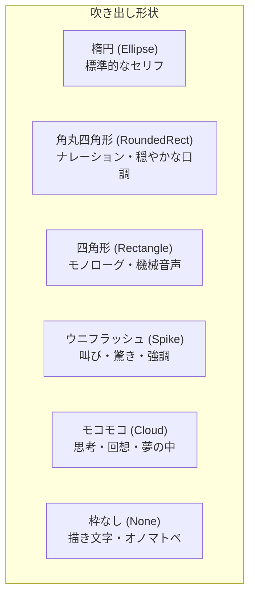

# テキストレイヤー＆吹き出し機能 使用方法ガイド
## (Text Layer & Balloon Guide)

『PaintSoft KABURAGI』の**テキストレイヤー**および**吹き出しツール**は、イラスト制作やマンガ・Webtoon制作において、セリフ、モノローグ、描き文字、擬音（オノマトペ）、ルビ（ふりがな）などを直感的かつ高度に作成・編集できるベクターベースの組版機能です。

---

## 目次
1. [テキストレイヤーの概要と特徴](#1-テキストレイヤーの概要と特徴)
2. [基本操作：テキスト・吹き出しの作成と選択](#2-基本操作テキスト吹き出しの作成と選択)
3. [文字・組版設定（書字方向・配置・はみ出し制御）](#3-文字組版設定書字方向配置はみ出し制御)
4. [リッチテキスト・ルビ（ふりがな）・インライン装飾](#4-リッチテキストルビふりがなインライン装飾)
5. [吹き出し形状とスタイル設定](#5-吹き出し形状とスタイル設定)
6. [キャンバス上でのインタラクティブ編集（サイズ・しっぽ・頂点変形）](#6-キャンバス上でのインタラクティブ編集サイズしっぽ頂点変形)
7. [レイヤー運用・便利なTips＆ショートカット一覧](#7-レイヤー運用便利なtipsショートカット一覧)

---

## 1. テキストレイヤーの概要と特徴

- **完全ベクター保持（非破壊編集）**  
  入力した文章、フォント設定、文字色、吹き出しの形状や頂点位置はすべて独立したベクターオブジェクトとして保持されます。拡大・縮小を行っても文字や枠線が劣化せず、いつでも再編集が可能です。
- **縦書き＆日本語組版に完全対応**  
  日本語マンガ特有の「縦書き」に対応。長音符（ー）やダッシュ・波線の自動回転、句読点（、。）や促音・拗音（っ・ゃ・ゅ・ょ等）の右上配置・配置補正を自動処理します。
- **ルビ（ふりがな）の高度なレンダリング**  
  青空文庫記法（`｜親文字《ルビ》`）や簡易ルビ（`親文字《ルビ》`）、Markdown風ルビ（`[親文字](ルビ)`）に対応。縦書きでは親文字の右側、横書きでは親文字の上に自動で美しい比率・配置で描画されます。
- **特殊形状吹き出し（ウニフラッシュ・モコモコ）の自由変形**  
  叫びのウニフラッシュや思考のモコモコ吹き出しは、ランダムな凸凹調整に加え、キャンバス上で頂点を直接ドラッグして自由に変形できます。
- **完全な Undo / Redo 対応**  
  文字入力、移動、拡大縮小、しっぽ調整、頂点変形など、すべての操作が `Ctrl+Z` / `Ctrl+Y` に対応しています。

```
[レイヤー構造の例]
▼ [通常] 効果・トーンレイヤー
▼ [テキスト] セリフレイヤー (TextLayer)  ← ベクター管理・いつでも再編集可能
  ├─ 吹き出し1: 主人公のセリフ (ウニフラッシュ + 縦書き + ルビ)
  └─ 吹き出し2: モノローグ (角丸四角形 + 枠線)
▼ [通常] 線画レイヤー
▼ [通常] 着彩レイヤー
```

---

## 2. 基本操作：テキスト・吹き出しの作成と選択

ツールボックスには、目的に応じて2種類のツールが用意されています：
- **テキストツール (`T`)**: 枠なし（文字のみ）のテキストをすばやく配置したいときに使用
- **吹き出しツール (`TextBalloon`)**: 枠線や背景、しっぽの付いた吹き出しを作成したいときに使用

```
[キャンバス操作]
ドラッグして矩形指定 ──▶ 新規吹き出し / テキスト自動生成 ──▶ テキスト入力欄へフォーカス
```

### ① 新規作成の手順
1. ツールボックスから **テキストツール (`T`)** または **吹き出しツール** を選択します。
2. キャンバス上で、配置したい場所に対角線上にドラッグして領域の大きさを指定します。  
   *※ドラッグせず単に左クリックした場合は、標準的なサイズ（テキストなら幅200×高さ80、吹き出しなら幅200×高さ130）で自動配置されます。*
3. 現在のアクティブレイヤーがテキストレイヤーでない場合、自動的に新しい「テキストレイヤー」が作成されます。
4. ドラッグ完了と同時に画面上の **テキスト設定パネル（ツールプロパティ）** のテキスト入力欄に自動でカーソルが入り、すぐにキーボードから文章を入力できます。

### ② テキストの選択と再編集
- テキストツール選択中、キャンバス上の既存の文字や吹き出しをクリックすると、そのアイテムが**選択状態**（水色のバウンディングボックスと編集ハンドルが表示）になります。
- 選択されたアイテムの設定内容（フォント、色、文章、形状など）がテキスト設定パネルに即座に読み込まれます。
- テキスト編集エリア（文字部分）をクリックすると、そのまま文章を編集できます。

---

## 3. 文字・組版設定（書字方向・配置・はみ出し制御）

テキスト設定パネルの **[フォント / 配置]** エリアで、文字組みを細かく設定できます。

```
┌──────────────────────────────────────────────┐
│ フォント: [ MS ゴシック           ▼ ] [ 18 ]pt │
│ [ B ] [ I ]  文字色: [ ■ ]                    │
│ 書字方向: [ ➡ 横書き ] [ ⬇ 縦書き ]           │
│ 水平揃え: [ 左 ] [ 中央 ] [ 右 ]              │
│ 垂直揃え: [ 上 ] [ 中央 ] [ 下 ]              │
│ はみ出し: [ 折り返す (Wrap)                ▼ ] │
└──────────────────────────────────────────────┘
```

### 1. フォントと文字スタイル
- **フォントファミリー**: システムにインストールされているすべてのTrueType / OpenTypeフォントから選択可能。
- **フォントサイズ (pt)**: 基本文字サイズを指定。
- **太字 (`B`) / 斜体 (`I`)**: テキスト全体のスタイルを一括指定。
- **文字色**: カラーピッカーから文字の色を自由に選択。

### 2. 書字方向（横書き / 縦書き）
- **横書き (`➡`)**: 一般的な左から右への水平方向組版。
- **縦書き (`⬇`)**: マンガや日本の商業出版標準の縦書き組版。
  - カタカナ・ひらがなの長音（ー）やダッシュ（―）は自動で縦向きに90度回転。
  - 句読点（、。）は文字の右上にオフセット配置。
  - 促音・拗音（っ、ゃ、ゅ、ょ 等）も右寄りに自動調整。
  - ルビ（ふりがな）は文字の **「右側」** に自動配置。

### 3. 配置（アライメント）
- **水平揃え**: 左揃え / 中央揃え / 右揃え
- **垂直揃え**: 上揃え / 中央揃え / 下揃え

### 4. はみ出し・折り返しモード（TextOverflowMode）
吹き出し枠や指定バウンディングボックスに対して、テキストが収まりきらない場合の動作を3種類から選択できます：

| モード | 動作・特徴 |
| :--- | :--- |
| **テキストを吹き出し/枠からはみ出して表示する**<br/>`(Overflow)` | 枠の大きさを超えても、文字を途切れさせずにすべて表示します。大声で叫ぶセリフなど枠から突き出させたい演出に最適です。 |
| **テキストが吹き出し/枠からはみ出る部分は表示しない**<br/>`(Clip)` | 吹き出しの枠外に出た文字を自動的にマスク（クリッピング）して非表示にします。枠内にきっちり収めたいデザインに適しています。 |
| **テキストが吹き出し/枠からはみ出る場合は折り返す**<br/>`(Wrap)` | 枠の端に到達した文字を自動的に改行（縦書きの場合は次の列へ折り返し）して枠内に収めます。長文のセリフに最適です。 |

---

## 4. リッチテキスト・ルビ（ふりがな）・インライン装飾

1つのセリフの中で「ここだけ文字を赤くしたい」「この単語だけ大きくしたい」「漢字にルビを振りたい」といった高度な装飾を簡単に行えます。

```
┌──────────────────────────────────────────────┐
│ [ B ] [ I ] [ 文字色 ] [ 24 pt ] [ ルビ ]    │
│ 表示切替: (o) タグ無し表示   ( ) タグあり表示 │
│ プレビュー倍率: [ 100 ] %                     │
├──────────────────────────────────────────────┤
│ 吾輩は[猫](ねこ)である。<color=red>名前</color>はまだ無い。 │
└──────────────────────────────────────────────┘
```

### ① 表示モードの切り替え
テキスト入力欄の下にあるボタングループで、表示方法を切り替えられます：
- **タグ無し表示（推奨）**:
  - 装飾タグ（`<color=...>` 等）を隠し、実際の文字のみをすっきり表示します。
  - 文字列をドラッグして選択し、上部の「太字」「文字色」「サイズ変更」「ルビ」ボタンを押すと、**選択された文字だけに装飾が自動適用**されます。
  - 右隣の **「表示倍率（50%〜200%）」** で、入力欄内の文字サイズを好みの大きさにスケーリングできます。
- **タグあり表示**:
  - 生のタグ文字列（`<b>...</b>` 等）を直接目視・手動編集できます。

### ② ルビ（ふりがな）の3つの記法
PaintSoft KABURAGI では、以下の3種類の記法すべてが自動認識されます：

1. **青空文庫記法**: `｜親文字《ルビ》` または `|親文字《ルビ》`  
   *※「｜」で親文字の範囲を明確に区切るため、漢字だけでなくカタカナ・ひらがな・英数字の混ざった単語にも確実にルビを振ることができます。*  
   *例: `｜テスト《てすと》`、`｜強敵《ライバル》`*
2. **簡易ルビ記法**: `親文字《ルビ》`  
   *※親文字の前の「｜」を省略した記法です。直前の漢字・カタカナ・ひらがな・英数字の連続を自動判別して親文字とみなします。*  
   *例: `漢字《かんじ》の文章です`*
3. **Markdown風記法**: `[親文字](ルビ)`  
   *例: `[魔法使い](マジシャン)`*

> [!TIP]
> **ルビ挿入ボタンの使い方**:  
> テキスト入力欄でルビを振りたい文字列を選択し、ツールバーの **[ルビ]** ボタンをクリックすると、ふりがな入力ダイアログが表示されます。ふりがなを入力して確定すると、選択文字に自動でルビ記法が設定されます。

### ③ インライン装飾タグ一覧

| 装飾内容 | タグ記法 | 例 |
| :--- | :--- | :--- |
| **太字** | `<b>テキスト</b>` または `**テキスト**` | `<b>ここを強調</b>` |
| **斜体** | `<i>テキスト</i>` | `<i>イタリック</i>` |
| **文字色** | `<color=色名または#HEX>テキスト</color>` | `<color=#ff3333>警告</color>` |
| **文字サイズ** | `<size=数値>テキスト</size>` (絶対指定)<br/>`<size=+4>` / `<size=-4>` (相対指定) | `<size=32>大声</size>` |

---

## 5. 吹き出し形状とスタイル設定

テキスト設定パネルの **[吹き出し]** エリアで、吹き出しの形状や外観を設定します。

```
┌──────────────────────────────────────────────┐
│ 形状: [ ウニフラッシュ (Spike)             ▼ ] │
├──────────────────────────────────────────────┤
│ 枠線太さ: [ 3.0 ] px   枠線色: [ ■ ]          │
│ 背景色:   [ □ ]       [ ] 背景を透明にする    │
├──────────────────────────────────────────────┤
│ [✔] フチ取りを追加                           │
│ フチ太さ: [ 4.0 ] px   フチ色: [ □ ]          │
└──────────────────────────────────────────────┘
```

### 1. 6種類の吹き出し形状



- **楕円 (`Ellipse`)**: 一般的な会話セリフ向けの定番形状。
- **角丸四角形 (`RoundedRect`)**: やや落ち着いたトーン、ナレーション、電子音など。
- **四角形 (`Rectangle`)**: モノローグ（心の声）や無機質な機械のナレーション。
- **ウニフラッシュ (`Spike`)**: 叫び、怒鳴り声、衝撃のオノマトペ。トゲの数・深さ・ランダム性を細かく制御可能。
- **モコモコ (`Cloud`)**: 頭の中の想像、回想シーン、柔らかい吐息。
- **枠なし (`None`)**: 枠や背景を描画せず、文字だけを配置。効果音や描き文字に最適（しっぽは自動的に非表示になります）。

### 2. 枠線・背景・フチ取り設定
- **枠線の太さ**: 吹き出しの輪郭線の幅（px）。
- **枠線色**: 輪郭線のカラー（標準: 黒）。
- **背景色**: 吹き出し内部の塗りつぶし色（標準: 白）。
  - **背景を透明にする**: チェックを入れると背景塗りをスキップし、コマの背景絵を透けさせます。
- **フチ取り（アウトライン）**:
  - `[✔] フチ取りを追加` をオンにすると、枠線のさらに外側に指定色の境界線を描画できます。
  - 背景に暗いトーンや効果線が敷かれている場所でも、白いフチ取りを付けることでセリフが埋もれず視認性を確保できます。

---

## 6. キャンバス上でのインタラクティブ編集（サイズ・しっぽ・頂点変形）

キャンバス上で選択中の吹き出しには、直感的に操作できる編集用ハンドルがリアルタイム表示されます。

```
       (TopLeft) ───■─── (Top) ───■─── (TopRight)
         │                                  │
         ■ (Left)    [ 中央ドラッグで移動 ]  ■ (Right)
         │                                  │
      (BottomLeft) ──■─── (Bottom) ─■── (BottomRight)
                                     \
                                      ○ (しっぽ曲率)
                                       \
                                        ● (しっぽ先端)
```

### 1. バウンディングボックスによる拡縮と移動
- **全体の移動**: 吹き出しの内側を左クリックしてドラッグすると、位置を自由に移動できます。
- **サイズ変更（拡縮）**: 四隅および各辺の中央にある四角いハンドル（8箇所）をドラッグすると、吹き出しやテキストエリアの幅・高さを自在にリサイズできます。

### 2. しっぽの直感操作（3つの円ハンドル）
吹き出しにしっぽがある場合、キャンバス上に3つの青い円形ハンドルが表示されます：
1. **しっぽ先端ハンドル（先端の丸）**:  
   ドラッグすると、キャラクターの口元など狙った位置にしっぽの先端を移動できます。
2. **しっぽカーブハンドル（中間地点の丸）**:  
   左右にドラッグすると、しっぽを弓なりにしならせる（曲率 -100〜100）ことができます。
3. **根元太さハンドル（吹き出し接合部の丸）**:  
   ドラッグしてしっぽの根元の太さ（幅 4〜150px）を伸縮できます。

> [!NOTE]
> 吹き出しの形状を「枠なし (文字のみ)」に設定している場合は、キャンバス上にしっぽの編集ハンドルは表示されません。

### 3. ウニフラッシュ／モコモコの自由頂点編集

ウニフラッシュおよびモコモコ形状では、プロパティパネルによる数値調整と、キャンバス上での直接編集を組み合わせられます。

```
[特殊形状設定パネル]
トゲの数: [ 16 ] (4〜64)   トゲの深さ: [ 25.0 ] px
回転角度: [ 0.0 ] 度       ランダム凸凹: [ 35 ] (0〜100)
[ 🎲 頂点再配置 (ランダムシード) ]
```

- **ランダム凸凹サイズ変更 (0〜100)**:  
  `0` で均等な幾何学的形状になります。`1以上` を設定すると、トゲの長さや根元の幅が自然なバラつきを持ち、勢いのある手描き風の叫びフラッシュになります。
- **[🎲 頂点再配置] ボタン**:  
  クリックするたびにシード値を再生成し、トゲの凸凹パターンを瞬時に再計算します。
- **キャンバス上での頂点個別ドラッグ**:  
  キャンバス上に表示される各トゲの先端（またはモコモコの頂点）を**マウスで直接掴んでドラッグ**できます。  
  特定の方向（叫んでいる相手の方向）だけにトゲを長く伸ばしたり、コマ枠の隙間に合わせてトゲを押し込むといったプロ向けの変形が可能です。

---

## 7. レイヤー運用・便利なTips＆ショートカット一覧

### 1. テキストレイヤーの効果的な使い方
- **複数セリフを1レイヤーにまとめる**:  
  1つのテキストレイヤーの中に、同一ページ内のすべてのセリフや吹き出しを含めることができます。一括で非表示にしたり、位置を調整する際に便利です。
- **オノマトペ・描き文字の分離**:  
  キャラクターのセリフ（フォント文字）と効果音・オノマトペ（手描き加筆を伴うもの）でテキストレイヤーを分けておくと、後からの修正や多言語ローカライズ時の差し替えが非常にスムーズになります。
- **ラスタライズによる手描き加工**:  
  吹き出しや文字に消しゴムツールで削りを入れたり、ブラシでトーン削りやグランジテクスチャを重ねたい場合は、メニューの **[レイヤー]** → **[レイヤーのラスタライズ]** を実行することで、通常のペイントレイヤーに変換して自由に描画加筆できます。

### 2. ショートカット一覧

| 操作 | ショートカット | 説明 |
| :--- | :--- | :--- |
| **テキストツール** | `T` | テキスト入力・編集ツールを選択 |
| **選択吹き出しの移動** | キャンバスドラッグ | 選択中吹き出しの内側を掴んで移動 |
| **頂点・サイズ変形** | ハンドルドラッグ | 8箇所の拡縮ハンドル、しっぽハンドル、トゲ頂点をドラッグ |
| **元に戻す** | `Ctrl + Z` | 直前のテキスト入力・変形・パラメータ変更を取り消す |
| **やり直し** | `Ctrl + Y` / `Ctrl + Shift + Z` | 取り消した操作を再適用 |
| **新規レイヤー作成** | `Ctrl + Shift + N` | 新しいレイヤーを追加 |
| **全選択解除** | 空白部分クリック | 選択状態を解除して新規作成待機状態にする |

---

### まとめ
PaintSoft KABURAGI のテキストレイヤーは、**「手軽に作れるプリセット性」** と **「プロの作画に応える頂点単位の自由度」** を両立しています。  
コマ割りフォルダやベクター線画と組み合わせることで、マンガ制作のネームから完成原稿・Webtoon制作までをシームレスに完結させることができます。
